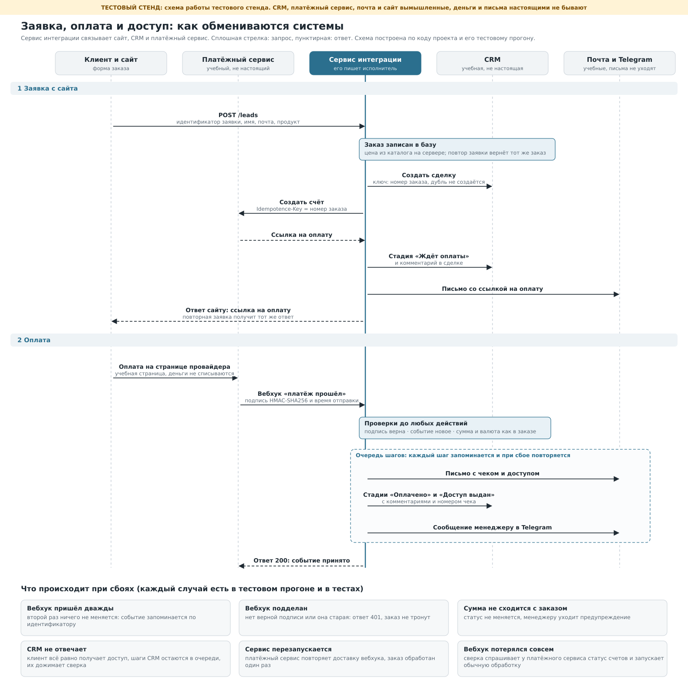

# Заявка → CRM → оплата → доступ: проект на Python

Сервис интеграции для сайта с оплатой. Принимает заявку, создаёт сделку в CRM и счёт в платёжном сервисе,
принимает подписанные уведомления об оплате (вебхуки), двигает сделку по стадиям, выдаёт доступ, пишет клиенту
и менеджеру. Сбой любой из внешних систем не теряет заказ: действие ждёт в очереди и выполняется позже.

**Проверено на тестовых сервисах.** CRM, платёжный сервис, почта с Telegram и сайт вымышленные, они
запускаются на вашем компьютере вместе с проектом (`mocks/`). Их API условные и не повторяют API
конкретной CRM или платёжной системы. Проект не запускался с реальными CRM, платёжным сервисом, почтой и
Telegram. Деньги и письма на стенде не настоящие.



## Быстрый запуск

```bash
pip install -r requirements.txt
python run.py
```

Проверено на Python 3.13 (Flask 3.1, requests 2.34), на других версиях не запускалось.

Что произойдёт: поднимутся пять локальных серверов (сайт, CRM, платёжный сервис, почта и Telegram, сервис
интеграции) и пройдут восемь сценариев. Каждый заканчивается проверками, при первой неудачной код выхода 1.
Прогон занимает около двух секунд, журнал сохраняется в `out/run.log`.

Чтобы поработать руками, запустите `python run.py --serve`: после сценариев стенд остаётся включённым.
В консоли будут адреса формы заказа и доски сделок CRM. Оформите заказ, нажмите на странице оплаты «Оплатить»
или «Отклонить платёж» и смотрите, как меняется сделка. Остановка: Ctrl+C.

Тесты (89 проверок, без внешних библиотек кроме Flask и requests): `python -m unittest discover -s tests -t .`

## Результат тестового прогона

| Показатель | Значение |
|---|---|
| Заказов / сделок в CRM | 8 / 8 |
| Дошли до «Доступ выдан» | 6 |
| Ждёт оплаты / отказ банка, ждёт повтора | 1 / 1 |
| События провайдера | оплата принята 6, отказ 2, запоздавший отказ после оплаты пропущен 1, повтор уже учтённой оплаты пропущен 1, сумма не сошлась 1 |
| Шагов выполнено, в очереди, «мёртвых» | 68, 0, 0 |
| Сообщений | 23: клиентам 16, менеджеру 7 |
| Проверок в сценариях | 44 |

## Сценарии

| № | Сценарий | Что проверяется |
|---|---|---|
| 1 | Обычная оплата | Заявка, сделка, счёт, оплата, доступ. Сделка доходит до «Доступ выдан», в её истории три записи. Клиент получает два письма, менеджер одно сообщение. |
| 2 | Двойной клик, чужие данные, подмена цены | Тот же номер заявки возвращает тот же заказ: второй сделки и второго счёта нет. Тот же номер с другим продуктом получает 409. Цена из тела запроса игнорируется. Пустое имя, неверная почта, неизвестный продукт получают 422. |
| 3 | Повтор вебхука | Провайдер дважды присылает обработанное событие. Ответ «duplicate», в CRM и почте ничего не прибавилось. |
| 4 | Поддельные вебхуки, сумма не сходится | Без подписи, с чужой подписью, со старой подписью и с подписью от другого тела: отказ 401. Настоящая подпись, но сумма 1 ₽ вместо 3 500 ₽: статус не меняется, в сделку и менеджеру уходит предупреждение. |
| 5 | Отказ банка, затем успех | Отказ: стадия «Оплата не прошла» и письмо клиенту со ссылкой для повтора. Повторная оплата по той же ссылке проходит. Запоздавший отказ после оплаты игнорируется, оплаченный заказ не откатывается. |
| 6 | CRM недоступна в момент оплаты | Оплата записана, доступ выдан, письмо ушло сразу. Два шага CRM ждут в очереди. После восстановления CRM сверка их выполняет, порядок записей верный, повторных писем нет. |
| 7 | Перезапуск сервиса | Шлюз дважды отвечает 502. Провайдер повторяет доставку (502, 502, 200), заказ обработан один раз. |
| 8 | Вебхук потерялся совсем | Уведомление не дошло. Сверка спрашивает у провайдера статус счетов, находит оплату и запускает обычную обработку. Запоздавшее уведомление потом распознаётся как уже учтённое. |

## Как это устроено

**Путь заказа.** Заявка с сайта: заказ записывается в базу, затем четыре шага (сделка в CRM, счёт, стадия
«Ждёт оплаты», письмо со ссылкой). Вебхук об оплате: проверки, затем пять шагов (доступ, письмо с чеком,
стадии «Оплачено» и «Доступ выдан», сообщение менеджеру). Полная схема в `docs/sequence.svg`.

**Статусы заказа.** `NEW` → `AWAITING_PAYMENT` → `PAYMENT_FAILED` или `PAID` → `ACCESS_GRANTED`. Статус
меняется только из ожидаемого предыдущего (проверка и запись одним действием), поэтому параллельные запросы
не затирают друг друга.

**Защита от дублей на каждом уровне.**

| Где | Чем защищено |
|---|---|
| Заявка с сайта | `lead_id` даёт один заказ; тот же `lead_id` с другими данными получает 409 |
| Сделка в CRM | `external_id` равен номеру заказа |
| Счёт у провайдера | заголовок `Idempotence-Key` равен номеру заказа |
| Комментарий в сделке | `uid` из номера заказа и названия шага |
| Вебхук | идентификатор события хранится в таблице `events` |
| Шаги очереди | уникальная пара «заказ + шаг», выполненный шаг не повторяется |

**Подпись вебхука.** Заголовок `X-Demo-Signature: t=<unix-время>,v1=<HMAC-SHA256(секрет, "<t>.<тело запроса>")>`.
Подпись проверяется по сырому телу до разбора JSON, сравнение за постоянное время, допустимое расхождение
времени 300 секунд (защита от повторной отправки перехваченного запроса). Причину отказа провайдеру не
сообщаем, она только в журнале.

**Очередь шагов.** Каждое действие во внешней системе записано как шаг в таблице `steps` до вызова и
помечается выполненным после. Запрос к внешней системе делается до трёх раз с удваивающейся паузой, если
она ответила 429, 500, 502, 503, 504 или не отвечает; остальные ответы 4xx не повторяются. Если система лежит,
её остальные шаги в этом запуске пропускаются, а шаги других систем выполняются: клиент получает доступ, даже
если CRM недоступна. Шаги CRM одного заказа идут строго по порядку: пока стадия «Оплачено» не записана, «Доступ
выдан» её не обгонит.

Шаг, который не удался 8 раз, считается «мёртвым»: в журнале запись об ошибке, а у сверки, в запуске которой это
случилось, код выхода 1 (удобно привязать к уведомлению планировщика). Мёртвый шаг сам больше не запускается и
виден в таблице `steps` (`status = 'dead'`), а следующие шаги CRM этого заказа ждут его. Когда причина устранена,
шаги возвращают в очередь вручную: `UPDATE steps SET status = 'pending', attempts = 0 WHERE status = 'dead'`.
Отдельной команды для этого нет.

**Сверка** (`python -m integration reconcile`, запускать по расписанию). Спрашивает у провайдера статус счетов,
по которым долго нет оплаты (вдруг вебхук потерялся), и повторяет отложенные шаги.

**Ответы сервиса.** `POST /leads`: 201 или 200 со ссылкой на оплату, 202 если счёт ещё не выставлен (ссылку
пришлём на почту), 400, 401, 409, 413, 422. `POST /webhooks/pay`: 200 (принято, повтор или пропущено), 400, 401, 413
и 503 с `Retry-After`, если счёт по заказу ещё не записан. Тело запроса больше 64 КБ отклоняется сразу.
`GET /health`: только `{"status": "ok"}`.

## Как подключить свои системы

1. **Запросы к CRM, платёжному сервису и почте** правятся в `integration/clients.py`. Методы должны вернуть то,
   что ждёт `service.py`:

   | Метод | Что возвращает |
   |---|---|
   | `CRM.create_deal` | `{"id": ...}`, повтор с тем же `external_id` возвращает ту же сделку |
   | `CRM.get_deal` | `{"stage": ...}` |
   | `CRM.set_stage` | любой ответ 2xx; при недопустимом переходе ответ 409 |
   | `CRM.comment` | любой ответ 2xx; `uid` защищает от повторной записи |
   | `Pay.create_invoice` | `{"id": ..., "pay_url": ...}` |
   | `Pay.get_invoice` | `{"id", "status", "amount_kop", "currency", "payment": {"id", "receipt": {"number"}}}` |
   | `Notifier.send` | любой ответ 2xx |

   Названия стадий (`NEW`, `AWAITING_PAYMENT`, `PAYMENT_FAILED`, `PAID`, `ACCESS_GRANTED`) сопоставляются со
   стадиями вашей воронки внутри `CRM.set_stage` и `CRM.get_deal`.
2. **Формат вебхука и подпись** у каждого провайдера свои. Подпись в `integration/signature.py`, разбор события
   в `Service.handle_webhook`, правила по статусам в `Service._decide`. Если провайдер события не подписывает,
   доверять событию можно только после запроса статуса платежа в его API: метод `Pay.get_invoice` для этого
   уже есть (его использует сверка).
3. **Порядок действий** задан списками `LEAD_PLAN` и `PAID_PLAN` в `integration/service.py`. Новый шаг это
   функция `_s_...` и строка в плане. Шаг должен быть безопасным для повтора.
4. **Каталог и цены** в `CATALOG` в `integration/config.py`. В работе его заменяют выгрузкой из вашей базы или CRM.
5. **Настройки** только из переменных окружения: `CRM_URL`, `CRM_TOKEN`, `PAY_URL`, `PAY_KEY`,
   `WEBHOOK_SECRET`, `MSG_URL`, `LEAD_TOKEN`, `ACCESS_SECRET`. Необязательные: `DB_PATH` (по умолчанию
   `integration.db`), `MANAGER_CHAT`, `ACCESS_BASE`. Без обязательных переменных сервис не стартует.
6. **Запуск:** `python -m integration serve --host 127.0.0.1 --port 8080` и по расписанию (например, cron раз в
   5–10 минут) `python -m integration reconcile`.
7. **Сайт** отправляет заявку на сервер вашего сайта, а тот обращается к сервису с заголовком
   `Authorization: Bearer <LEAD_TOKEN>`. Токен нельзя класть в код страницы. Пример серверного обработчика
   формы: `mocks/site.py`.

## Ограничения

- Проект проверен только на тестовых сервисах. Каждая реальная CRM и каждый платёжный сервис требуют своего
  адаптера и проверки: формат запросов, стадии воронки, правила вебхуков, лимиты и тестовый режим.
- Формат вебхука, заголовок подписи и события условные. У реального провайдера они другие.
- Чек на стенде условный и нефискальный (`DEMO-000001`). Фискализация по 54-ФЗ настраивается на стороне платёжного
  сервиса или онлайн-кассы, в проекте её нет.
- Шаги выполняются внутри обработчика вебхука. Если CRM отвечает медленно, провайдер может не дождаться
  ответа и повторит доставку (это безопасно, но неудобно). В работе событие сохраняют, сразу отвечают 200, а
  шаги выполняет фоновый обработчик.
- SQLite и встроенный сервер Flask подходят для проверки. В работе нужны PostgreSQL, waitress или gunicorn за
  HTTPS-прокси и блокировка шагов на уровне базы (при нескольких процессах). Блокировки в коде защищают один
  процесс.
- Письма и сообщения доставляются «минимум один раз»: если процесс упадёт между отправкой и записью шага, письмо
  может уйти второй раз.
- Выдача доступа это заглушка: ссылка считается из номера заказа и секрета. Подключение к вашей платформе
  (курсы, чат, облако) отдельный шаг.
- Реальные почта и Telegram не подключались: письма и сообщения уходят в учебный почтовый сервис.
- Не реализованы: возвраты, подписки и регулярные платежи, заказы из нескольких позиций, промокоды, интерфейс
  администратора.
- Сам сервис (строки с тегом `svc`) пишет в журнал номера заказов и заявок, но не имена и адреса почты. В
  тестовом журнале имена видны, потому что их пишут «рассказчик» сценариев и тестовая почта. Тексты ошибок
  внешних систем попадают в журнал обрезанными до 120 символов: у реальных систем их стоит проверить на
  персональные данные.

## Структура

```
run.py              сквозной тестовый прогон: 8 сценариев, 44 проверки, журнал в out/run.log
stand.py             сборка тестового стенда (для run.py и тестов)
integration/         сервис интеграции
  config.py            настройки и каталог продуктов
  signature.py         подпись вебхуков
  http.py              запросы к внешним системам с повторами
  clients.py           обёртки над CRM, платёжным сервисом, почтой
  store.py             SQLite: заказы, события, очередь шагов
  service.py           вся логика: заявка, вебхук, шаги, сверка
  web.py               три адреса: /leads, /webhooks/pay, /health
  __main__.py          python -m integration serve | reconcile
mocks/               тестовые CRM, платёжный сервис, почта и Telegram, сайт
docs/                схема обмена (sequence.svg, sequence.png) и скрипт make_diagram.py, который её строит
tests/               unittest: 89 проверок (подпись, запросы, хранилище, учебные сервисы, сценарии, запуск)
```
