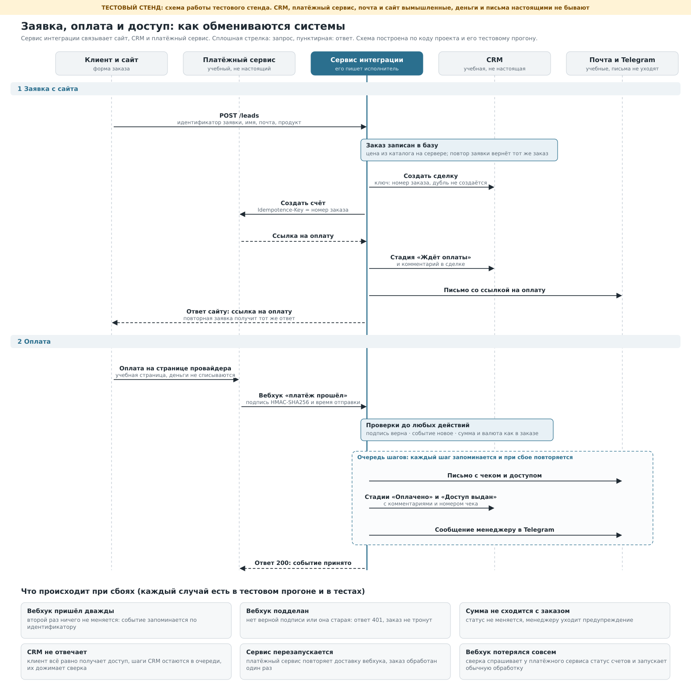

# Lead → CRM → Payment → Access: a Python project

An integration service for a website that takes payments. It accepts a lead, creates a deal in the CRM and an
invoice with the payment provider, accepts signed payment notifications (webhooks), moves the deal through stages,
grants access and notifies the customer and the manager. If any external system fails, the order is not lost: the
action waits in a queue and runs later.

**Live demo page:** https://skayman777-svg.github.io/crm-payment/

**Tested on mock services.** The CRM, payment provider, email/Telegram and website are fictional; they run on your
machine together with the project (`mocks/`). Their APIs are generic and don’t copy any specific CRM or payment
provider. The project has not been run against a real CRM, payment provider, email or Telegram. No real money or
emails on the test stand.



## Quick start

```bash
pip install -r requirements.txt
python run.py
```

Tested on Python 3.13 (Flask 3.1, requests 2.34).

What happens: five local servers start (website, CRM, payment provider, email/Telegram, integration service) and
eight scenarios run. Each ends with checks; on the first failure the exit code is 1. The run takes about two
seconds, the log is saved to `out/run.log`.

To try it by hand, run `python run.py --serve`: after the scenarios the stand stays up. The console shows the
URLs of the order form and the CRM deal board. Place an order, click “Pay” or “Decline payment” on the payment page
and watch the deal change. Stop with Ctrl+C.

Tests (89 checks, no external libraries except Flask and requests): `python -m unittest discover -s tests -t .`

## Test run results

| Metric | Value |
|---|---|
| Orders / CRM deals | 8 / 8 |
| Reached “Access granted” | 6 |
| Awaiting payment / declined, awaiting retry | 1 / 1 |
| Provider events | 6 paid, 2 declined, 1 late decline after payment skipped, 1 repeat of a recorded payment skipped, 1 amount mismatch |
| Steps done, queued, dead | 68, 0, 0 |
| Messages | 23: 16 to customers, 7 to the manager |
| Scenario checks | 44 |

## Scenarios

| # | Scenario | What is checked |
|---|---|---|
| 1 | Happy path | Lead, deal, invoice, payment, access. The deal reaches “Access granted” with three history entries. The customer gets two emails, the manager one message. |
| 2 | Double click, other data, price tampering | The same lead ID returns the same order: no second deal or invoice. The same ID with another product gets 409. The price from the request body is ignored. Empty name, bad email, unknown product get 422. |
| 3 | Webhook retry | The provider sends a processed event twice. The reply is “duplicate”, nothing extra in the CRM or email. |
| 4 | Forged webhooks, amount mismatch | No signature, a foreign signature, an old signature, a signature of a different body: all rejected with 401. Genuine signature but $0.01 instead of $35: status unchanged, a warning goes to the deal and the manager. |
| 5 | Bank decline, then success | Decline: “Payment failed” stage and an email with a retry link. The retry with the same link succeeds. A late decline after payment is ignored, the paid order is not rolled back. |
| 6 | CRM down at payment time | Payment recorded, access granted, email sent right away. Two CRM steps wait in the queue. Once the CRM is back, reconciliation runs them in the right order, no duplicate emails. |
| 7 | Service restart | The gateway returns 502 twice. The provider retries delivery (502, 502, 200), the order is processed once. |
| 8 | Webhook lost entirely | The notification never arrives. Reconciliation asks the provider for invoice statuses, finds the payment and runs normal processing. The late notification is later recognized as already recorded. |

## How to connect your own systems

1. **CRM, payment provider and email requests** live in `integration/clients.py`. The methods must return what
   `service.py` expects:

   | Method | Returns |
   |---|---|
   | `CRM.create_deal` | `{"id": ...}`; a retry with the same `external_id` returns the same deal |
   | `CRM.get_deal` | `{"stage": ...}` |
   | `CRM.set_stage` | any 2xx; 409 on a forbidden transition |
   | `CRM.comment` | any 2xx; `uid` protects against duplicate entries |
   | `Pay.create_invoice` | `{"id": ..., "pay_url": ...}` |
   | `Pay.get_invoice` | `{"id", "status", "amount_kop", "currency", "payment": {"id", "receipt": {"number"}}}` |
   | `Notifier.send` | any 2xx |

   Stage names (`NEW`, `AWAITING_PAYMENT`, `PAYMENT_FAILED`, `PAID`, `ACCESS_GRANTED`) are mapped to your pipeline
   stages inside `CRM.set_stage` and `CRM.get_deal`.
2. **Webhook format and signature** differ per provider. The signature is in `integration/signature.py`, event parsing
   in `Service.handle_webhook`, status rules in `Service._decide`. If a provider doesn’t sign events, trust an event
   only after querying the payment status via its API: `Pay.get_invoice` already does that (reconciliation uses it).
3. **The order of actions** is defined by the `LEAD_PLAN` and `PAID_PLAN` lists in `integration/service.py`. A new step
   is a `_s_...` function plus a line in the plan. Every step must be safe to retry.
4. **Catalog and prices** are in `CATALOG` in `integration/config.py`. In production it is replaced by an export from
   your database or CRM.
5. **Settings** come only from environment variables: `CRM_URL`, `CRM_TOKEN`, `PAY_URL`, `PAY_KEY`,
   `WEBHOOK_SECRET`, `MSG_URL`, `LEAD_TOKEN`, `ACCESS_SECRET`. Optional: `DB_PATH` (default `integration.db`),
   `MANAGER_CHAT`, `ACCESS_BASE`. The service won’t start without the required ones.
6. **Run:** `python -m integration serve --host 127.0.0.1 --port 8080`, and on a schedule (e.g. cron every
   5–10 minutes) `python -m integration reconcile`.
7. **The website** sends the lead to your site’s backend, which calls the service with the header
   `Authorization: Bearer <LEAD_TOKEN>`. Never put the token in page code. A sample backend form handler:
   `mocks/site.py`.

## Limitations

- Tested only on mock services. Every real CRM and payment provider needs its own adapter and testing: request
  format, pipeline stages, webhook rules, rate limits and sandbox mode.
- The webhook format, signature header and events are generic. A real provider will differ.
- The receipt on the stand is a non-fiscal placeholder (`DEMO-000001`). Tax receipts are configured on the payment
  provider side; the project doesn’t include them.
- Steps run inside the webhook handler. If the CRM is slow, the provider may time out and retry delivery (safe, but
  not ideal). In production the event is stored, 200 is returned immediately and a background worker runs the steps.
- SQLite and the built-in Flask server are fine for testing. Production needs PostgreSQL, waitress or gunicorn behind
  an HTTPS proxy, and database-level step locking (with multiple processes). The in-code locks protect one process.
- Emails and messages are delivered “at least once”: if the process crashes between sending and recording the step,
  an email may go out twice.
- Access granting is a stub: the link is derived from the order number and a secret. Connecting your platform
  (courses, chat, cloud) is a separate step.
- Real email and Telegram were not connected: messages go to the mock mail service.
- Not implemented: refunds, subscriptions and recurring payments, multi-item orders, promo codes, admin UI.
- The service itself (log lines tagged `svc`) logs order and lead IDs, not names or emails. Names are visible in the
  test log because the scenario narrator and the mock mail write them. Error texts from external systems are logged
  truncated to 120 characters; with real systems, check them for personal data.

## Structure

```
run.py              end-to-end test run: 8 scenarios, 44 checks, log in out/run.log
stand.py            test stand assembly (for run.py and tests)
integration/        the integration service
  config.py           settings and product catalog
  signature.py        webhook signatures
  http.py             requests to external systems with retries
  clients.py          wrappers over the CRM, payment provider, email
  store.py            SQLite: orders, events, step queue
  service.py          all logic: lead, webhook, steps, reconciliation
  web.py              three endpoints: /leads, /webhooks/pay, /health
  __main__.py         python -m integration serve | reconcile
mocks/              mock CRM, payment provider, email/Telegram, website
docs/               message flow diagram (sequence.svg, sequence.png) and make_diagram.py that builds it
tests/              unittest: 89 checks (signature, requests, storage, mock services, scenarios, CLI)
```
